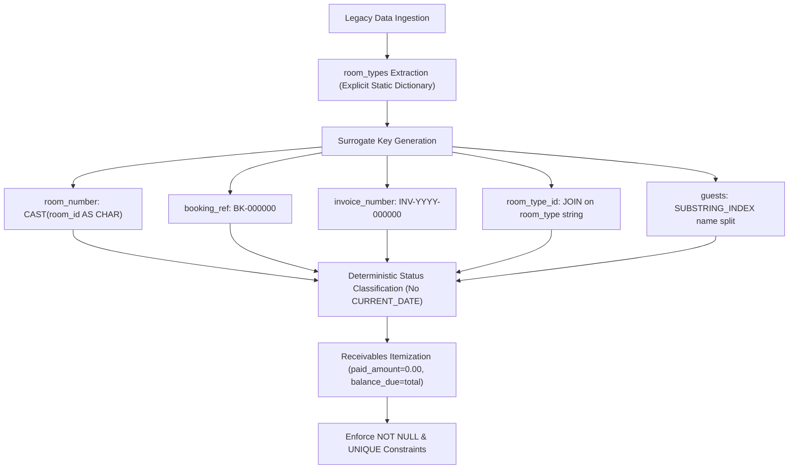

# Legacy-to-Production Database Migration Plan & Field Mapping

**Document:** `docs/DATA_MIGRATION_PLAN.md`  
**Status:** Approved Technical Specification (Revision 2 - Deterministic Hardening)  
**Source Schema:** `hotel_db.sql` (5 Legacy Tables)  
**Target Schema:** SQLAlchemy Production Models (`backend/app/models/`, 9 Tables)  

---

## 1. Executive Summary & Migration Principles

This document specifies the complete, column-by-column migration mapping from the legacy MySQL prototype database (`hotel_db.sql`) to the normalized, production-grade SQLAlchemy domain architecture (`backend/app/models/`).

### Core Engineering Principles
1. **Zero Data Loss**: Legacy columns containing historical customer, room, or financial data (`guests.name`, `rooms.room_type`, `rooms.status`, `rooms.cleaned`, `bills.amount`, `bookings.booking_date`) are never dropped until their data has been completely transformed, backfilled, and verified in production columns.
2. **Three-Phase Phased Migration**:
   - **Phase 1 (Additive DDL)**: Provision new independent tables (`room_types`, `payments`, `housekeeping`, `maintenance`), widen legacy columns, and add all new columns as `NULLABLE`.
   - **Phase 2 (Data Backfill & Transformation - DML)**: Execute deterministic, idempotent SQL transformation scripts to populate surrogate keys, normalized foreign keys, split strings, and status enums.
   - **Phase 3 (Constraint Enforcement & Decommissioning - Final DDL)**: Apply `NOT NULL`, `UNIQUE`, foreign keys, and check constraints; drop obsolete legacy columns.
3. **Strict Determinism**: Transformations must produce the exact same target state regardless of execution date, time, or environment. No transformation rule may rely on `CURRENT_DATE`, `NOW()`, or arbitrary system clock lookups to infer historical lifecycle states.
4. **No Synthetic Financial Events**: In the absence of payment ledgers in the legacy database, migrations must not fabricate historical payment events or assume bills were settled.
5. **No Fictitious Contact Data**: Missing contact attributes must not be populated with fake numbers (e.g., `000-000-0000`). Missing data must use explicit semantic sentinels or pre-migration remediation.

---

## 2. Field Classification Taxonomy

Every target field generated or defaulted during migration is classified under one of three strict categories:

* **`[Source-Derived]`**: Directly extracted, mapped, or calculated from existing legacy columns (e.g., `created_at` from `booking_date`, `first_name` from `name`).
* **`[Deterministic Generated Data]`**: Algorithmic generation using primary keys, natural keys, or static lookup dictionaries guaranteed to produce identical, collision-free values on repeated runs (e.g., `room_number = CAST(room_id AS CHAR)`, `booking_ref = CONCAT('BK-', LPAD(booking_id, 6, '0'))`, `invoice_number = CONCAT('INV-', YEAR(...), '-', LPAD(bill_id, 6, '0'))`).
* **`[Provisional Assumption]`**: Baseline operational defaults assigned in the absence of legacy data that **require post-migration operational verification** by hotel management or staff (e.g., `floor = 1`, `is_smoking = FALSE`, `paid_amount = 0.00`, `phone = 'UNSPECIFIED'`).

---

## 3. Table-by-Table Migration Mappings

### 3.1 Table: `users`

The legacy `users` table contains 4 columns. Production retains all primary credentials, widens the password hash column, introduces an enumeration for roles, and adds profile and audit attributes.

| # | Legacy Column | Production Column | Classification | Transformation / Backfill Rule | NULL During Migration | Final Constraint | Eventually Dropped | Data-Loss Risk & Mitigation |
| :--- | :--- | :--- | :--- | :--- | :--- | :--- | :--- | :--- |
| 1 | `user_id INT PK` | `user_id` | **`[Source-Derived]`** | Direct 1:1 transfer. Retain existing primary keys to preserve referential integrity. | **NO** | `INT AUTO_INCREMENT PRIMARY KEY` | **NO** | **None**: Primary key sequence is preserved directly. |
| 2 | `username VARCHAR(50)` | `username` | **`[Source-Derived]`** | Direct 1:1 transfer. | **NO** | `VARCHAR(50) NOT NULL UNIQUE, INDEX` | **NO** | **None**: Preserves exact uniqueness constraint. |
| 3 | `password VARCHAR(100)` | `password` | **`[Source-Derived]`** | Alter column type from `VARCHAR(100)` to `VARCHAR(255)`. Legacy password hashes (PBKDF2/Werkzeug) are preserved without re-hashing. | **NO** | `VARCHAR(255) NOT NULL` | **NO** | **None**: Widening column storage prevents hash truncation when upgrading to bcrypt/argon2. |
| 4 | `role VARCHAR(20)` | `role` | **`[Source-Derived]`** | Transform string to `user_role_enum`. Map legacy strings:<br>`LOWER(TRIM(role))` $\to$ `'admin'`, `'manager'`, `'receptionist'`, `'housekeeper'`, `'maintenance'`. Legacy default was `'receptionist'`. Fallback for unrecognized roles is `'receptionist'`. | **YES** (during column alter) | `ENUM('admin', 'manager', 'receptionist', 'housekeeper', 'maintenance') NOT NULL DEFAULT 'receptionist'` | **NO** (type modified) | **LOW**: Unrecognized strings default to `'receptionist'`. Legacy roles should be audited before migration. |
| 5 | *(None)* | `email` | **`[Provisional Assumption]`** | Add column as nullable. Backfill with `NULL`. Optional deterministic placeholder: `CONCAT(username, '@hotel.internal')`. | **YES** | `VARCHAR(120) NULL UNIQUE, INDEX` | **NO** (New Column) | **None**: MySQL permits multiple `NULL` values under a unique constraint. |
| 6 | *(None)* | `full_name` | **`[Deterministic Generated Data]`** | Add column as nullable. Backfill with capitalized username: `CONCAT(UCASE(LEFT(username, 1)), LCASE(SUBSTRING(username, 2)))`. | **YES** | `VARCHAR(100) NULL` | **NO** (New Column) | **None**. |
| 7 | *(None)* | `is_active` | **`[Provisional Assumption]`** | Add column with default `TRUE`. Backfill: `UPDATE users SET is_active = 1 WHERE is_active IS NULL;` | **YES** (during add) | `BOOLEAN NOT NULL DEFAULT 1` | **NO** (New Column) | **None**: All existing accounts remain enabled. |
| 8 | *(None)* | `created_at` | **`[Provisional Assumption]`** | Add column. Backfill with fixed migration baseline timestamp (`'2026-01-01 00:00:00'`). | **YES** (during add) | `DATETIME NOT NULL DEFAULT CURRENT_TIMESTAMP` | **NO** (New Column) | **None**. |
| 9 | *(None)* | `updated_at` | **`[Provisional Assumption]`** | Add column. Backfill with fixed migration baseline timestamp (`'2026-01-01 00:00:00'`). | **YES** (during add) | `DATETIME NOT NULL DEFAULT CURRENT_TIMESTAMP ON UPDATE CURRENT_TIMESTAMP` | **NO** (New Column) | **None**. |

---

### 3.2 Table: `guests`

The legacy `guests` table stored a single combined `name` string and lacked audit tracking and identification document management.

| # | Legacy Column | Production Column | Classification | Transformation / Backfill Rule | NULL During Migration | Final Constraint | Eventually Dropped | Data-Loss Risk & Mitigation |
| :--- | :--- | :--- | :--- | :--- | :--- | :--- | :--- | :--- |
| 1 | `guest_id INT PK` | `guest_id` | **`[Source-Derived]`** | Direct 1:1 transfer. | **NO** | `INT AUTO_INCREMENT PRIMARY KEY` | **NO** | **None**. |
| 2 | `name VARCHAR(100)` | `first_name`, `last_name` | **`[Source-Derived]`** | **Decompose combined name string**:<br>`first_name = SUBSTRING_INDEX(TRIM(name), ' ', 1)`<br>`last_name = IF(LOCATE(' ', TRIM(name)) > 0, SUBSTRING(TRIM(name), LOCATE(' ', TRIM(name)) + 1), 'Guest')`<br>If legacy `name` is `NULL` or empty, set `first_name = 'Unknown'`, `last_name = 'Guest'`. | **YES** (columns created as nullable before backfill) | `first_name VARCHAR(50) NOT NULL`<br>`last_name VARCHAR(50) NOT NULL`<br>`INDEX idx_guests_name (last_name, first_name)` | **YES** (`guests.name` dropped in Phase 3) | **HIGH**: Complex names (e.g., "Mary Jane Watson", "Dr. Robert Smith Jr.", "Ludwig van Beethoven") will have middle names/suffixes grouped into `last_name`. Must perform data validation before dropping `name`. |
| 3 | `phone VARCHAR(15)` | `phone` | **`[Provisional Assumption]`** *(if NULL)* | **Explicit Semantic Sentinel Policy**:<br>Do **NOT** insert fake numerical strings (`000-000-0000`).<br>1. Run pre-migration audit to identify missing phones.<br>2. For unresolvable legacy records with `phone IS NULL` or whitespace, backfill with explicit sentinel: `'UNSPECIFIED'`.<br>3. Widen column from `VARCHAR(15)` to `VARCHAR(25)` and apply non-empty constraint. | **YES** (before backfill) | `VARCHAR(25) NOT NULL, INDEX`<br>`CHECK (LENGTH(TRIM(phone)) > 0)` | **NO** | **MEDIUM**: Sentinel string `'UNSPECIFIED'` prevents invalid SMS/telephony dialing while satisfying non-null check constraints. Requires front-desk prompt to collect real phone on guest's next check-in. |
| 4 | `email VARCHAR(100)` | `email` | **`[Source-Derived]`** | Alter column from `VARCHAR(100)` to `VARCHAR(120)`. Add secondary index. | **YES** | `VARCHAR(120) NULL, INDEX` | **NO** | **None**: Widening column storage is non-destructive. |
| 5 | `address TEXT` | `address` | **`[Source-Derived]`** | Direct 1:1 transfer. | **YES** | `TEXT NULL` | **NO** | **None**. |
| 6 | *(None)* | `id_type` | **`[Provisional Assumption]`** | Add column. Backfill as `NULL`. | **YES** | `ENUM('passport', 'national_id', 'driving_license', 'other') NULL` | **NO** (New Column) | **None**: Identification documents were not captured in legacy system. |
| 7 | *(None)* | `id_number` | **`[Provisional Assumption]`** | Add column. Backfill as `NULL`. | **YES** | `VARCHAR(50) NULL`<br>`UNIQUE uq_guest_id_doc (id_type, id_number)` | **NO** (New Column) | **None**. |
| 8 | *(None)* | `city` | **`[Provisional Assumption]`** | Add column. Backfill as `NULL`. | **YES** | `VARCHAR(50) NULL` | **NO** (New Column) | **None**: Unstructured address strings are kept in `address`. |
| 9 | *(None)* | `country` | **`[Provisional Assumption]`** | Add column. Backfill as `NULL`. | **YES** | `VARCHAR(50) NULL` | **NO** (New Column) | **None**. |
| 10 | *(None)* | `postal_code` | **`[Provisional Assumption]`** | Add column. Backfill as `NULL`. | **YES** | `VARCHAR(20) NULL` | **NO** (New Column) | **None**. |
| 11 | *(None)* | `vip_status` | **`[Provisional Assumption]`** | Add column with default `FALSE`. Backfill: `UPDATE guests SET vip_status = 0 WHERE vip_status IS NULL;` | **YES** (during add) | `BOOLEAN NOT NULL DEFAULT 0` | **NO** (New Column) | **None**. |
| 12 | *(None)* | `notes` | **`[Provisional Assumption]`** | Add column. Backfill as `NULL`. | **YES** | `TEXT NULL` | **NO** (New Column) | **None**. |
| 13 | *(None)* | `created_at` | **`[Provisional Assumption]`** | Add column. Backfill: `UPDATE guests SET created_at = '2026-01-01 00:00:00' WHERE created_at IS NULL;` | **YES** (during add) | `DATETIME NOT NULL DEFAULT CURRENT_TIMESTAMP` | **NO** (New Column) | **None**. |
| 14 | *(None)* | `updated_at` | **`[Provisional Assumption]`** | Add column. Backfill: `UPDATE guests SET updated_at = '2026-01-01 00:00:00' WHERE updated_at IS NULL;` | **YES** (during add) | `DATETIME NOT NULL DEFAULT CURRENT_TIMESTAMP ON UPDATE CURRENT_TIMESTAMP` | **NO** (New Column) | **None**. |

---

### 3.3 Table: `rooms` $\to$ Normalized `room_types` + `rooms`

Production normalizes room classifications into `room_types` and manages physical rooms via `rooms`.

#### A. Target Entity: `room_types` (New Table)

Populated using an **explicit deterministic lookup dictionary** based on legacy room types:

| Legacy `room_type` | Target `name` | Target `code` | Target `base_price` | Target `max_occupancy` | Target `bed_config` | Classification |
| :--- | :--- | :--- | :--- | :--- | :--- | :--- |
| `'Single'` | `'Single'` | `'SINGLE'` | `100.00` | `1` | `'1 Single Bed'` | **`[Source-Derived]`** |
| `'Deluxe'` | `'Deluxe'` | `'DELUXE'` | `250.00` | `2` | `'1 King Bed'` | **`[Source-Derived]`** |
| `'Double'` | `'Double'` | `'DOUBLE'` | `150.00` | `2` | `'1 Double Bed'` | **`[Source-Derived]`** |
| `'Suite'` | `'Suite'` | `'SUITE'` | `400.00` | `4` | `'1 King Bed + 1 Sofa Bed'` | **`[Source-Derived]`** |
| `'Standard'` | `'Standard'` | `'STANDARD'` | `120.00` | `2` | `'1 Queen Bed'` | **`[Source-Derived]`** |
| *(Any Novel / Other)* | `TRIM(room_type)` | `UPPER(REPLACE(TRIM(room_type),' ','_'))` | `100.00` | `2` | `'1 Standard Bed'` | **`[Provisional Assumption]`** |

**Deterministic Ingestion Query**:
```sql
INSERT INTO room_types (name, code, description, base_price, max_occupancy, bed_config, is_active, created_at, updated_at)
SELECT DISTINCT 
    TRIM(room_type) AS name,
    CASE TRIM(room_type)
        WHEN 'Single' THEN 'SINGLE'
        WHEN 'Deluxe' THEN 'DELUXE'
        WHEN 'Double' THEN 'DOUBLE'
        WHEN 'Suite' THEN 'SUITE'
        WHEN 'Standard' THEN 'STANDARD'
        ELSE UPPER(REGEXP_REPLACE(TRIM(room_type), '[^a-zA-Z0-9]+', '_'))
    END AS code,
    CONCAT(TRIM(room_type), ' Room') AS description,
    CASE TRIM(room_type)
        WHEN 'Single' THEN 100.00
        WHEN 'Deluxe' THEN 250.00
        WHEN 'Double' THEN 150.00
        WHEN 'Suite' THEN 400.00
        WHEN 'Standard' THEN 120.00
        ELSE 100.00
    END AS base_price,
    CASE TRIM(room_type)
        WHEN 'Single' THEN 1
        WHEN 'Deluxe' THEN 2
        WHEN 'Double' THEN 2
        WHEN 'Suite' THEN 4
        WHEN 'Standard' THEN 2
        ELSE 2
    END AS max_occupancy,
    CASE TRIM(room_type)
        WHEN 'Single' THEN '1 Single Bed'
        WHEN 'Deluxe' THEN '1 King Bed'
        WHEN 'Double' THEN '1 Double Bed'
        WHEN 'Suite' THEN '1 King Bed + 1 Sofa Bed'
        WHEN 'Standard' THEN '1 Queen Bed'
        ELSE '1 Standard Bed'
    END AS bed_config,
    1 AS is_active,
    '2026-01-01 00:00:00' AS created_at,
    '2026-01-01 00:00:00' AS updated_at
FROM rooms
WHERE room_type IS NOT NULL AND TRIM(room_type) != '';
```

#### B. Target Entity: `rooms` (Modified Table)

> [!WARNING]
> **Operational Verification Requirement**: `floor = 1` and `is_smoking = FALSE` are **provisional migration defaults**. Facilities management must conduct a physical inventory audit post-migration to verify accurate floor locations and smoking policies.

| # | Legacy Column | Production Column | Classification | Transformation / Backfill Rule | NULL During Migration | Final Constraint | Eventually Dropped | Data-Loss Risk & Mitigation |
| :--- | :--- | :--- | :--- | :--- | :--- | :--- | :--- | :--- |
| 1 | `room_id INT PK` | `room_id` | **`[Source-Derived]`** | Direct 1:1 transfer. Primary key retained. | **NO** | `INT AUTO_INCREMENT PRIMARY KEY` | **NO** | **None**. |
| 2 | *(None)* | `room_number` | **`[Deterministic Generated Data]`** | **Generate unique physical identifier**:<br>`UPDATE rooms SET room_number = CAST(room_id AS CHAR) WHERE room_number IS NULL;` | **YES** (added as NULL, backfilled, then set to NOT NULL) | `VARCHAR(20) NOT NULL UNIQUE, INDEX` | **NO** (New Column) | **HIGH**: Attempting to add `VARCHAR(20) NOT NULL UNIQUE` without phased backfill aborts with `Error 1138 / Error 1062`. |
| 3 | *(None)* | `floor` | **`[Provisional Assumption]`** | **Provisional migration default**: Set to `1`.<br>`UPDATE rooms SET floor = 1 WHERE floor IS NULL;`<br>*(Requires operational verification)*. | **YES** (during add) | `INT NOT NULL DEFAULT 1`<br>`CHECK (floor >= -2)` | **NO** (New Column) | **LOW**: Facilities staff must audit room records to record actual multi-floor numbers. |
| 4 | `room_type VARCHAR(50)` | `room_type_id` | **`[Source-Derived]`** | **Normalized Foreign Key Resolution**:<br>1. Populate `room_types` using deterministic dictionary.<br>2. Backfill:<br>`UPDATE rooms r JOIN room_types rt ON TRIM(r.room_type) = rt.name SET r.room_type_id = rt.room_type_id;` | **YES** (during backfill phase) | `INT NULL, FK REFERENCES room_types(room_type_id) ON DELETE RESTRICT` | **YES** (`rooms.room_type` dropped in Phase 3) | **CRITICAL**: If `rooms.room_type` is dropped before creating `room_types` rows and linking `room_type_id`, all physical rooms lose their categorization. |
| 5 | `status VARCHAR(20)` | `operational_status` | **`[Source-Derived]`** | **Deterministic String to Enum Mapping**:<br>`UPDATE rooms SET operational_status = CASE`<br>`  WHEN LOWER(TRIM(status)) = 'available' THEN 'available'`<br>`  WHEN LOWER(TRIM(status)) IN ('booked', 'occupied') THEN 'occupied'`<br>`  WHEN LOWER(TRIM(status)) IN ('maintenance', 'under_maintenance') THEN 'under_maintenance'`<br>`  WHEN LOWER(TRIM(status)) = 'out_of_service' THEN 'out_of_service'`<br>`  ELSE 'available' END;` | **YES** (added as NULL, populated, then NOT NULL) | `ENUM('available', 'occupied', 'out_of_service', 'under_maintenance') NOT NULL DEFAULT 'available'` | **YES** (`rooms.status` dropped in Phase 3; Python hybrid property `@status` preserves backwards compatibility) | **LOW**: Arbitrary legacy status strings are safely mapped to valid operational states. |
| 6 | `cleaned TINYINT` | `cleanliness_status` | **`[Source-Derived]`** | **Binary to Enum Mapping**:<br>`UPDATE rooms SET cleanliness_status = CASE`<br>`  WHEN cleaned = 1 THEN 'clean'`<br>`  ELSE 'dirty' END;` | **YES** (added as NULL, populated, then NOT NULL) | `ENUM('clean', 'dirty', 'inspecting', 'cleaning_in_progress') NOT NULL DEFAULT 'clean'` | **YES** (`rooms.cleaned` dropped in Phase 3; Python hybrid property `@cleaned` preserves backwards compatibility) | **None**: Binary clean state maps directly to enum. |
| 7 | *(None)* | `is_smoking` | **`[Provisional Assumption]`** | **Provisional migration default**: Set to `FALSE` (`0`).<br>`UPDATE rooms SET is_smoking = 0 WHERE is_smoking IS NULL;`<br>*(Requires operational verification)*. | **YES** (during add) | `BOOLEAN NOT NULL DEFAULT 0` | **NO** (New Column) | **LOW**: Must be verified before enforcing room allocation for smoking/non-smoking guests. |
| 8 | *(None)* | `notes` | **`[Provisional Assumption]`** | Add column. Backfill as `NULL`. | **YES** | `TEXT NULL` | **NO** (New Column) | **None**. |
| 9 | *(None)* | `created_at` | **`[Provisional Assumption]`** | Add column. Backfill with `'2026-01-01 00:00:00'`. | **YES** (during add) | `DATETIME NOT NULL DEFAULT CURRENT_TIMESTAMP` | **NO** (New Column) | **None**. |
| 10 | *(None)* | `updated_at` | **`[Provisional Assumption]`** | Add column. Backfill with `'2026-01-01 00:00:00'`. | **YES** (during add) | `DATETIME NOT NULL DEFAULT CURRENT_TIMESTAMP ON UPDATE CURRENT_TIMESTAMP` | **NO** (New Column) | **None**. |

---

### 3.4 Table: `bookings`

The legacy `bookings` table recorded reservations without reservation reference codes, rate breakdowns, guest counts, or booking lifecycle states.

| # | Legacy Column | Production Column | Classification | Transformation / Backfill Rule | NULL During Migration | Final Constraint | Eventually Dropped | Data-Loss Risk & Mitigation |
| :--- | :--- | :--- | :--- | :--- | :--- | :--- | :--- | :--- |
| 1 | `booking_id INT PK` | `booking_id` | **`[Source-Derived]`** | Direct 1:1 transfer. | **NO** | `INT AUTO_INCREMENT PRIMARY KEY` | **NO** | **None**. |
| 2 | *(None)* | `booking_ref` | **`[Deterministic Generated Data]`** | **Deterministic reservation identifier**:<br>`UPDATE bookings SET booking_ref = CONCAT('BK-', LPAD(booking_id, 6, '0')) WHERE booking_ref IS NULL;` | **YES** (added as NULL, backfilled, then set to NOT NULL) | `VARCHAR(32) NOT NULL UNIQUE, INDEX` | **NO** (New Column) | **HIGH**: Applying `NOT NULL UNIQUE` without prior backfill will abort migration. |
| 3 | `guest_id INT` | `guest_id` | **`[Source-Derived]`** | Retain foreign key. If orphaned records exist (`guest_id IS NULL`), assign to fallback guest account (`1`) prior to enforcing `NOT NULL`. | **YES** (before audit) | `INT NOT NULL, FK REFERENCES guests(guest_id) ON DELETE RESTRICT, INDEX` | **NO** | **MEDIUM**: Legacy schema allowed `NULL` guest foreign keys. |
| 4 | *(None)* | `room_type_id` | **`[Source-Derived]`** | **Derive room type from booked room**:<br>`UPDATE bookings b JOIN rooms r ON b.room_id = r.room_id SET b.room_type_id = r.room_type_id WHERE b.room_type_id IS NULL;` | **YES** | `INT NULL, FK REFERENCES room_types(room_type_id) ON DELETE RESTRICT` | **NO** (New Column) | **None**: Resolves room category even if specific room assignment is changed. |
| 5 | `room_id INT` | `room_id` | **`[Source-Derived]`** | Retain foreign key. Reconfigure delete rule to `ON DELETE SET NULL`. | **YES** | `INT NULL, FK REFERENCES rooms(room_id) ON DELETE SET NULL, INDEX` | **NO** | **None**: Enables retaining historical reservations even if a physical room is decommissioned. |
| 6 | `check_in_date DATE` | `check_in_date` | **`[Source-Derived]`** | Backfill any `NULL` records with `DATE(booking_date)` or fixed baseline. | **YES** (before backfill) | `DATE NOT NULL` | **NO** | **LOW**: Legacy permitted `NULL`. Production requires valid date. |
| 7 | `check_out_date DATE` | `check_out_date` | **`[Source-Derived]`** | Validate chronological check constraint. If `check_out_date <= check_in_date`, repair:<br>`UPDATE bookings SET check_out_date = DATE_ADD(check_in_date, INTERVAL 1 DAY) WHERE check_out_date IS NOT NULL AND check_out_date <= check_in_date;` | **YES** | `DATE NULL`<br>`CHECK (check_out_date IS NULL OR check_out_date > check_in_date)` | **NO** | **MEDIUM**: Inconsistent legacy date entries will violate the check constraint unless repaired during backfill. |
| 8 | `booking_date TIMESTAMP` | `created_at` | **`[Source-Derived]`** | Transfer timestamp directly:<br>`UPDATE bookings SET created_at = booking_date WHERE created_at IS NULL;` | **YES** (during add) | `DATETIME NOT NULL DEFAULT CURRENT_TIMESTAMP` | **YES** (`bookings.booking_date` dropped in Phase 3) | **None**: Historical booking timestamps are preserved 1:1 in `created_at`. |
| 9 | *(None)* | `actual_check_in` | **`[Provisional Assumption]`** | Add column. Set to `NULL`. (Do not fabricate check-in timestamps). | **YES** | `DATETIME NULL` | **NO** (New Column) | **None**. |
| 10 | *(None)* | `actual_check_out` | **`[Provisional Assumption]`** | Add column. Set to `NULL`. (Do not fabricate checkout timestamps). | **YES** | `DATETIME NULL`<br>`CHECK (actual_check_out IS NULL OR actual_check_out >= actual_check_in)` | **NO** (New Column) | **None**. |
| 11 | *(None)* | `num_adults` | **`[Provisional Assumption]`** | Add column with default `1`. Backfill: `UPDATE bookings SET num_adults = 1 WHERE num_adults IS NULL;` | **YES** (during add) | `INT NOT NULL DEFAULT 1`<br>`CHECK (num_adults > 0)` | **NO** (New Column) | **None**. |
| 12 | *(None)* | `num_children` | **`[Provisional Assumption]`** | Add column with default `0`. Backfill: `UPDATE bookings SET num_children = 0 WHERE num_children IS NULL;` | **YES** (during add) | `INT NOT NULL DEFAULT 0`<br>`CHECK (num_children >= 0)` | **NO** (New Column) | **None**. |
| 13 | *(None)* | `nightly_rate` | **`[Source-Derived]`** | Add column. Backfill from linked room type base price or fallback `100.00`:<br>`UPDATE bookings b LEFT JOIN room_types rt ON b.room_type_id = rt.room_type_id SET b.nightly_rate = COALESCE(rt.base_price, 100.00) WHERE b.nightly_rate IS NULL;` | **YES** (during add) | `DECIMAL(10, 2) NOT NULL DEFAULT 0.00` | **NO** (New Column) | **None**. |
| 14 | *(None)* | `total_amount` | **`[Source-Derived]`** | Add column. Backfill from legacy bill amount or calculated duration:<br>`UPDATE bookings b LEFT JOIN bills bl ON b.booking_id = bl.booking_id SET b.total_amount = COALESCE(bl.amount, b.nightly_rate * GREATEST(DATEDIFF(COALESCE(b.check_out_date, DATE_ADD(b.check_in_date, INTERVAL 1 DAY)), b.check_in_date), 1)) WHERE b.total_amount IS NULL;` | **YES** (during add) | `DECIMAL(10, 2) NOT NULL DEFAULT 0.00` | **NO** (New Column) | **None**. |
| 15 | *(None)* | `status` | **`[Deterministic Generated Data]`** | **Deterministic Historical Inference (No `CURRENT_DATE`)**:<br>Infer status purely from historical records:<br>1. If a bill was issued (`EXISTS in bills`): reservation completed lifecycle $\to$ `'checked_out'`.<br>2. If no bill exists but both dates are present: reservation was established $\to$ `'confirmed'`.<br>3. If `check_in_date` is present but `check_out_date` is NULL: open reservation $\to$ `'pending'`.<br>`UPDATE bookings b LEFT JOIN bills bl ON b.booking_id = bl.booking_id SET b.status = CASE`<br>`  WHEN bl.bill_id IS NOT NULL THEN 'checked_out'`<br>`  WHEN b.check_out_date IS NOT NULL THEN 'confirmed'`<br>`  ELSE 'pending' END WHERE b.status IS NULL;` | **YES** (during add) | `ENUM('pending', 'confirmed', 'checked_in', 'checked_out', 'cancelled', 'no_show') NOT NULL DEFAULT 'confirmed', INDEX` | **NO** (New Column) | **None**: 100% deterministic regardless of when migration executes. |
| 16 | *(None)* | `special_requests` | **`[Provisional Assumption]`** | Add column. Backfill as `NULL`. | **YES** | `TEXT NULL` | **NO** (New Column) | **None**. |
| 17 | *(None)* | `cancellation_reason`| **`[Provisional Assumption]`** | Add column. Backfill as `NULL`. | **YES** | `TEXT NULL` | **NO** (New Column) | **None**. |
| 18 | *(None)* | `created_by_user_id`| **`[Provisional Assumption]`** | Add column. Backfill with `NULL` (or Admin `1`). | **YES** | `INT NULL, FK REFERENCES users(user_id) ON DELETE SET NULL` | **NO** (New Column) | **None**. |
| 19 | *(None)* | `updated_at` | **`[Source-Derived]`** | Add column. Backfill: `UPDATE bookings SET updated_at = COALESCE(booking_date, '2026-01-01 00:00:00') WHERE updated_at IS NULL;` | **YES** (during add) | `DATETIME NOT NULL DEFAULT CURRENT_TIMESTAMP ON UPDATE CURRENT_TIMESTAMP` | **NO** (New Column) | **None**. |

---

### 3.5 Table: `bills`

Production enforces a 1:1 folio relationship (`UNIQUE(booking_id)`), direct guest association, invoice numbering, and arithmetic check constraints.

> [!IMPORTANT]
> **Financial Integrity Policy**: Migration **must not assume legacy bills were paid**. Because the legacy schema lacked payment transaction records, all legacy bills are migrated as **unsettled issued receivables** (`paid_amount = 0.00`, `balance_due = total_amount`, `status = 'issued'`). No synthetic payment rows are created in `payments`. Finance staff must reconcile actual payments post-migration against physical deposit logs.

| # | Legacy Column | Production Column | Classification | Transformation / Backfill Rule | NULL During Migration | Final Constraint | Eventually Dropped | Data-Loss Risk & Mitigation |
| :--- | :--- | :--- | :--- | :--- | :--- | :--- | :--- | :--- |
| 1 | `bill_id INT PK` | `bill_id` | **`[Source-Derived]`** | Direct 1:1 transfer. | **NO** | `INT AUTO_INCREMENT PRIMARY KEY` | **NO** | **None**. |
| 2 | *(None)* | `invoice_number` | **`[Deterministic Generated Data]`** | **Deterministic fiscal invoice identifier**:<br>`UPDATE bills SET invoice_number = CONCAT('INV-', YEAR(COALESCE(issued_date, '2026-01-01')), '-', LPAD(bill_id, 6, '0')) WHERE invoice_number IS NULL;` | **YES** (added as NULL, backfilled, then set to NOT NULL) | `VARCHAR(50) NOT NULL UNIQUE, INDEX` | **NO** (New Column) | **HIGH**: Enforcing `NOT NULL UNIQUE` without backfill will abort migration. |
| 3 | `booking_id INT` | `booking_id` | **`[Source-Derived]`** | **Enforce 1:1 Booking Folio Constraint**:<br>1. Check for duplicates: `SELECT booking_id, COUNT(*) FROM bills GROUP BY booking_id HAVING COUNT(*) > 1;`<br>2. Consolidate duplicate records if found.<br>3. Enforce `UNIQUE(booking_id)`. | **NO** | `INT NOT NULL UNIQUE, FK REFERENCES bookings(booking_id) ON DELETE RESTRICT` | **NO** | **CRITICAL**: If legacy data contains multiple bills for one booking, applying `UNIQUE(booking_id)` fails with `Error 1062`. Duplicates must be consolidated before constraint creation. |
| 4 | *(None)* | `guest_id` | **`[Source-Derived]`** | **Link bill to guest via booking**:<br>`UPDATE bills b JOIN bookings bk ON b.booking_id = bk.booking_id SET b.guest_id = bk.guest_id WHERE b.guest_id IS NULL;` | **YES** (during backfill) | `INT NOT NULL, FK REFERENCES guests(guest_id) ON DELETE RESTRICT, INDEX` | **NO** (New Column) | **HIGH**: If orphaned bills exist with invalid `booking_id`, backfill will leave `guest_id` as NULL. Orphaned bills must be resolved. |
| 5 | `amount DECIMAL(10,2)` | `total_amount`, `subtotal_amount`, `paid_amount`, `balance_due` | `total_amount` & `subtotal_amount`: **`[Source-Derived]`**<br>`paid_amount` & `balance_due`: **`[Deterministic Generated Data]`** | **Migration-Safe Accounting Decomposition (No Invented Payments)**:<br>`UPDATE bills SET`<br>`  subtotal_amount = COALESCE(amount, 0.00),`<br>`  tax_amount = 0.00,`<br>`  discount_amount = 0.00,`<br>`  total_amount = COALESCE(amount, 0.00),`<br>`  paid_amount = 0.00,`<br>`  balance_due = COALESCE(amount, 0.00)`<br>`WHERE total_amount IS NULL OR total_amount = 0.00;`<br>*(Strictly satisfies check constraints: `total_amount = subtotal + tax - discount` and `balance_due = total - paid`)*. | **YES** (columns added as NULL, populated, then NOT NULL) | `subtotal_amount DECIMAL(10,2) NOT NULL DEFAULT 0.00`<br>`tax_amount DECIMAL(10,2) NOT NULL DEFAULT 0.00`<br>`discount_amount DECIMAL(10,2) NOT NULL DEFAULT 0.00`<br>`total_amount DECIMAL(10,2) NOT NULL DEFAULT 0.00`<br>`paid_amount DECIMAL(10,2) NOT NULL DEFAULT 0.00`<br>`balance_due DECIMAL(10,2) NOT NULL DEFAULT 0.00` | **YES** (`bills.amount` dropped in Phase 3) | **CRITICAL**: Do not assume bills were paid. Setting `paid_amount = 0.00` and `balance_due = total_amount` preserves financial audit integrity without inventing fictitious payment transactions. |
| 6 | *(None)* | `status` | **`[Deterministic Generated Data]`** | **Deterministic Status Assignment**:<br>Since payments are not assumed, all billed items are classified by document issuance state:<br>`UPDATE bills SET status = CASE`<br>`  WHEN issued_date IS NOT NULL THEN 'issued'`<br>`  ELSE 'draft' END WHERE status IS NULL;` | **YES** (during add) | `ENUM('draft', 'issued', 'partially_paid', 'paid', 'voided', 'refunded') NOT NULL DEFAULT 'draft', INDEX` | **NO** (New Column) | **None**: Fully deterministic and audit-compliant. |
| 7 | `issued_date TIMESTAMP` | `issued_date` | **`[Source-Derived]`** | Direct transfer from legacy timestamp. Convert to `DATETIME(6)`. | **YES** | `DATETIME NULL` | **NO** | **None**. |
| 8 | *(None)* | `notes` | **`[Provisional Assumption]`** | Add column. Set migration marker: `'Migrated from legacy billing system without verified payment records'`. | **YES** | `TEXT NULL` | **NO** (New Column) | **None**. |
| 9 | *(None)* | `created_at` | **`[Source-Derived]`** | Add column. Backfill: `UPDATE bills SET created_at = COALESCE(issued_date, '2026-01-01 00:00:00') WHERE created_at IS NULL;` | **YES** (during add) | `DATETIME NOT NULL DEFAULT CURRENT_TIMESTAMP` | **NO** (New Column) | **None**. |
| 10 | *(None)* | `updated_at` | **`[Source-Derived]`** | Add column. Backfill: `UPDATE bills SET updated_at = COALESCE(issued_date, '2026-01-01 00:00:00') WHERE updated_at IS NULL;` | **YES** (during add) | `DATETIME NOT NULL DEFAULT CURRENT_TIMESTAMP ON UPDATE CURRENT_TIMESTAMP` | **NO** (New Column) | **None**. |

---

### 3.6 Target-Only Entities (Provisioned Clean)

These tables have no legacy counterparts and are created cleanly in Phase 1:

1. **`payments`**:
   - Provisioned with **zero rows**.
   - **No Synthetic Payments**: Because the legacy database never tracked payment methods, transaction references, or cashier IDs, no rows are inserted into `payments` during migration. All payments must be recorded through legitimate application channels or verified historical payment receipts.
2. **`housekeeping`**:
   - Provisioned with zero rows. Operational cleaning and inspection workflows begin fresh upon deployment.
3. **`maintenance`**:
   - Provisioned with zero rows. Legacy rooms flagged with `status = 'maintenance'` have their operational status set to `'under_maintenance'`. Facilities staff create specific maintenance tickets post-migration describing the physical fault.

---

## 4. Synthetic Business Rule & Field Generators



### 4.1 Generator: `room_number` (`[Deterministic Generated Data]`)
* **Format**: String representation of integer `room_id`.
* **SQL Algorithm**:
  ```sql
  UPDATE rooms 
  SET room_number = CAST(room_id AS CHAR)
  WHERE room_number IS NULL;
  ```
* **Collision Guarantee**: 1:1 mapping with primary key; guaranteed strictly unique and reproducible.

### 4.2 Generator: `booking_ref` (`[Deterministic Generated Data]`)
* **Format**: Monotonic prefix with zero-padded booking ID: `BK-{6_DIGIT_ID}`.
* **SQL Algorithm**:
  ```sql
  UPDATE bookings 
  SET booking_ref = CONCAT('BK-', LPAD(booking_id, 6, '0'))
  WHERE booking_ref IS NULL;
  ```
* **Collision Guarantee**: 1:1 mapping with `booking_id` guarantees zero duplicates.

### 4.3 Generator: `invoice_number` (`[Deterministic Generated Data]`)
* **Format**: `INV-{YEAR}-{6_DIGIT_ID}`.
* **SQL Algorithm**:
  ```sql
  UPDATE bills 
  SET invoice_number = CONCAT('INV-', YEAR(COALESCE(issued_date, '2026-01-01')), '-', LPAD(bill_id, 6, '0'))
  WHERE invoice_number IS NULL;
  ```
* **Collision Guarantee**: Combines issuance year with primary key sequence, guaranteeing audit compliance and uniqueness.

### 4.4 Generator: `room_type_id` (`[Source-Derived]`)
* **Resolution**:
  1. Populate `room_types` via the explicit static mapping dictionary in Section 3.3.
  2. Map `rooms.room_type_id = room_types.room_type_id` where `rooms.room_type = room_types.name`.
  3. Map `bookings.room_type_id = rooms.room_type_id` via `bookings.room_id = rooms.room_id`.

### 4.5 Generator: `first_name` and `last_name` (`[Source-Derived]`)
* **Deterministic Tokenizer**:
  ```sql
  UPDATE guests 
  SET 
      first_name = CASE 
          WHEN name IS NULL OR TRIM(name) = '' THEN 'Unknown'
          ELSE SUBSTRING_INDEX(TRIM(name), ' ', 1)
      END,
      last_name = CASE 
          WHEN name IS NULL OR TRIM(name) = '' THEN 'Guest'
          WHEN LOCATE(' ', TRIM(name)) > 0 THEN SUBSTRING(TRIM(name), LOCATE(' ', TRIM(name)) + 1)
          ELSE 'Guest'
      END
  WHERE first_name IS NULL OR last_name IS NULL;
  ```

### 4.6 Generator: Status Enums (`[Deterministic Generated Data]`)
* **`users.role`**:
  ```sql
  UPDATE users SET role = CASE 
      WHEN LOWER(TRIM(role)) IN ('admin', 'manager', 'receptionist', 'housekeeper', 'maintenance') THEN LOWER(TRIM(role))
      ELSE 'receptionist'
  END;
  ```
* **`rooms.operational_status`**:
  `'available' -> 'available'`, `'booked' -> 'occupied'`, `'maintenance' -> 'under_maintenance'`, fallback `'available'`.
* **`rooms.cleanliness_status`**:
  `cleaned = 1 -> 'clean'`, `cleaned = 0 / NULL -> 'dirty'`.
* **`bookings.status` (Strictly Deterministic - No `CURRENT_DATE`)**:
  ```sql
  UPDATE bookings b 
  LEFT JOIN bills bl ON b.booking_id = bl.booking_id 
  SET b.status = CASE 
      WHEN bl.bill_id IS NOT NULL THEN 'checked_out'
      WHEN b.check_out_date IS NOT NULL THEN 'confirmed'
      ELSE 'pending' 
  END 
  WHERE b.status IS NULL;
  ```
* **`bills.status` (Strictly Deterministic)**:
  ```sql
  UPDATE bills SET status = CASE 
      WHEN issued_date IS NOT NULL THEN 'issued' 
      ELSE 'draft' 
  END 
  WHERE status IS NULL;
  ```

### 4.7 Generator: Monetary & Receivables Defaults
* **`room_types.base_price`**: Single $\to$ `100.00`, Deluxe $\to$ `250.00`, Double $\to$ `150.00`, Suite $\to$ `400.00`, Standard $\to$ `120.00`, novel fallback $\to$ `100.00`.
* **`bookings.nightly_rate`**: Inherits `room_types.base_price` (fallback `100.00`).
* **`bookings.total_amount`**: Inherits legacy `bills.amount` or `nightly_rate * DATEDIFF(check_out, check_in)`.
* **`bills` Accounting Decomposition**:
  `subtotal_amount = amount`, `tax_amount = 0.00`, `discount_amount = 0.00`, `total_amount = amount`, `paid_amount = 0.00`, `balance_due = amount`.

### 4.8 Generator: Audit Timestamps
* **`created_at`**:
  - `bookings.created_at = bookings.booking_date` (`[Source-Derived]`)
  - `bills.created_at = bills.issued_date` (`[Source-Derived]`)
  - `users.created_at = '2026-01-01 00:00:00'` (`[Provisional Assumption]`)
  - `guests.created_at = '2026-01-01 00:00:00'` (`[Provisional Assumption]`)
  - `rooms.created_at = '2026-01-01 00:00:00'` (`[Provisional Assumption]`)
* **`updated_at`**: Initialized to match `created_at`. Configured with `ON UPDATE CURRENT_TIMESTAMP`.

---

## 5. Summary of Values by Classification Category

| Field | Target Table | Classification | Default / Generated Value | Rationale & Verification Requirement |
| :--- | :--- | :--- | :--- | :--- |
| `user_id`, `username`, `password` | `users` | **`[Source-Derived]`** | Legacy values | Direct 1:1 migration. |
| `role` | `users` | **`[Source-Derived]`** | Cleaned string $\to$ Enum | Mapped to enum with fallback to `'receptionist'`. |
| `first_name`, `last_name` | `guests` | **`[Source-Derived]`** | Tokenized `name` | Delimiter split on first space; remainder to `last_name`. |
| `operational_status` | `rooms` | **`[Source-Derived]`** | Mapped from `status` | Direct state translation. |
| `cleanliness_status` | `rooms` | **`[Source-Derived]`** | Mapped from `cleaned` | Binary conversion (`1` $\to$ clean, `0` $\to$ dirty). |
| `created_at` (bookings, bills) | `bookings`, `bills` | **`[Source-Derived]`** | Legacy timestamp | Direct transfer of `booking_date` / `issued_date`. |
| `subtotal_amount`, `total_amount` | `bills` | **`[Source-Derived]`** | Legacy `amount` | Revenue transferred into itemized ledger. |
| `room_number` | `rooms` | **`[Deterministic Generated Data]`** | `CAST(room_id AS CHAR)` | Guaranteed unique sequence without collisions. |
| `booking_ref` | `bookings` | **`[Deterministic Generated Data]`** | `CONCAT('BK-', LPAD(booking_id, 6, '0'))` | Monotonic, deterministic reservation code. |
| `invoice_number` | `bills` | **`[Deterministic Generated Data]`** | `CONCAT('INV-', YEAR(...), '-', LPAD(bill_id, 6, '0'))` | Fiscal audit invoice number. |
| `status` | `bookings` | **`[Deterministic Generated Data]`** | Inferred from bill & checkout existence | Purely historical; independent of migration run date. |
| `paid_amount` | `bills` | **`[Deterministic Generated Data]`** | `0.00` | Baseline accounting: no payment events fabricated. |
| `balance_due` | `bills` | **`[Deterministic Generated Data]`** | `total_amount - 0.00 = total_amount` | Strictly satisfies check constraint `chk_bill_balance`. |
| `status` | `bills` | **`[Deterministic Generated Data]`** | `'issued'` (or `'draft'`) | Based strictly on `issued_date IS NOT NULL`. |
| `phone` (when NULL) | `guests` | **`[Provisional Assumption]`** | `'UNSPECIFIED'` | Semantic sentinel avoiding fake numbers; prompts staff update. |
| `floor` | `rooms` | **`[Provisional Assumption]`** | `1` | **Requires physical operational verification**. |
| `is_smoking` | `rooms` | **`[Provisional Assumption]`** | `FALSE` (`0`) | **Requires physical operational verification**. |
| `vip_status` | `guests` | **`[Provisional Assumption]`** | `FALSE` (`0`) | Default non-VIP customer status. |
| `is_active` | `users` | **`[Provisional Assumption]`** | `TRUE` (`1`) | Preserves account access for existing users. |
| `tax_amount`, `discount_amount` | `bills` | **`[Provisional Assumption]`** | `0.00` | Legacy had no tax/discount split. |
| `num_adults`, `num_children` | `bookings` | **`[Provisional Assumption]`** | `1`, `0` | Standard single-guest baseline occupancy. |
| `id_type`, `id_number`, address fields | `guests` | **`[Provisional Assumption]`** | `NULL` | KYC data unrecorded in legacy; to be collected at check-in. |

---

## 6. Irreducible Legacy Data Limitations (Non-Automatable Data)

The following items cannot be synthesized or migrated through automated SQL transformations and require operational intervention:

| # | Domain Entity | Field / Data Item | Reason Automated Migration Is Impossible | Mitigation & Recommended Manual Action |
| :--- | :--- | :--- | :--- | :--- |
| **1** | **Guests** | Complex & Multi-part Names | Names like "Dr. John Doe Jr." or "Maria de la Cruz" cannot be parsed accurately into `first_name` and `last_name` using whitespace delimiters. Nobility particles, prefixes, and suffixes will be lumped into `last_name`. | Export names with multiple space delimiters for manual receptionist review. Flag guests with default `last_name = 'Guest'` for identity verification during check-in. |
| **2** | **Guests** | Identification Type & Number | Legacy schema captured no KYC/identity documentation (`id_type`, `id_number`). | Leave `id_type` and `id_number` as `NULL`. Mandate identity capture in frontend upon guest's next check-in. |
| **3** | **Guests** | Missing Phone Numbers | Legacy records with missing phone numbers cannot have real contact details manufactured. | Export list of guests with `'UNSPECIFIED'` phone for front-desk follow-up during check-in or reservation lookup. |
| **4** | **Guests** | Normalized City, Country, Postal Code | `guests.address` contains unparsed, non-standardized multi-line text. International addresses vary widely and cannot be parsed reliably via regex without false positives. | Keep unparsed text in `guests.address`. Leave `city`, `country`, `postal_code` as `NULL`. |
| **5** | **Bills / Payments** | Historical Payment Settlement Status | Legacy database recorded no payments, payment methods, or cashier logs. | All legacy bills enter production as `'issued'` with full balance due (`paid_amount = 0.00`, `balance_due = total_amount`). Accounting team must manually record settlement receipts from external bank/cash journals. |
| **6** | **Bills** | Duplicate Bills for One Booking | Legacy permitted multiple `bills` rows per `booking_id`. Production enforces `UNIQUE(booking_id)` (1:1 folio constraint). | Run duplicate detection query prior to Phase 3. If duplicate bills exist, finance staff must consolidate invoice items into a single bill before `UNIQUE` constraint is applied. |
| **7** | **Bills** | Historical Tax & Discount Itemization | Legacy recorded a single net `amount`. Itemized tax rates, VAT/GST breakdowns, and promotional discounts cannot be retroactively calculated without historical invoice PDFs. | Set `subtotal_amount = total_amount`, `tax_amount = 0.00`, `discount_amount = 0.00`. New itemized calculations apply only to post-migration bills. |
| **8** | **Rooms** | Physical Floor & Smoking Policy | Legacy `rooms` had no `floor` or `is_smoking` flag. Automated script sets `floor = 1` and `is_smoking = FALSE`. | Facilities manager must conduct a room inventory audit in admin UI to update actual floor numbers and smoking designations prior to room allocation. |
| **9** | **Bookings** | Exact Actual Check-in / Check-out Times | Legacy recorded only calendar `check_in_date` and `check_out_date` with no real-time keycard or desk timestamps. | Leave `actual_check_in` and `actual_check_out` as `NULL`. |
| **10** | **Bookings** | Audit Trail User Attribution | Legacy had no `created_by_user_id` tracking which employee created a reservation. | Historical records have `created_by_user_id` set to `NULL` (or Admin `1`). |

---

## 7. Execution Roadmap: 3-Phase Alembic Strategy

```text
[Phase 1: Additive DDL]
  ├── CREATE TABLE room_types
  ├── CREATE TABLE payments, housekeeping, maintenance (clean empty tables)
  ├── ALTER TABLE users (widen password to 255, add columns as NULL)
  ├── ALTER TABLE guests (add first_name, last_name, etc. as NULL)
  ├── ALTER TABLE rooms (add room_number, room_type_id, status enums as NULL)
  ├── ALTER TABLE bookings (add booking_ref, total_amount, enums as NULL)
  └── ALTER TABLE bills (add invoice_number, guest_id, totals as NULL)
       │
[Phase 2: Idempotent Deterministic Data Backfill & DML]
  ├── Seed room_types using deterministic mapping dictionary
  ├── Backfill rooms.room_number = CAST(room_id AS CHAR)
  ├── Backfill rooms.room_type_id, operational_status, cleanliness_status
  ├── Backfill guests.first_name, guests.last_name; set unresolvable phone = 'UNSPECIFIED'
  ├── Backfill bookings.booking_ref = CONCAT('BK-', LPAD(booking_id, 6, '0'))
  ├── Backfill bookings.status using deterministic historical rules (No CURRENT_DATE)
  ├── Backfill bills.invoice_number, guest_id
  ├── Backfill bills: paid_amount = 0.00, balance_due = total_amount, status = 'issued' (NO FAKE PAYMENTS)
  └── Pre-Constraint Verification Audit (0 nulls in mandatory fields, 0 duplicate keys)
       │
[Phase 3: Final Constraint Enforcement & Column Decommissioning]
  ├── ALTER TABLE rooms MODIFY room_number NOT NULL UNIQUE
  ├── ALTER TABLE guests MODIFY first_name NOT NULL, last_name NOT NULL, phone NOT NULL
  ├── ALTER TABLE bookings MODIFY booking_ref NOT NULL UNIQUE, check_in_date NOT NULL
  ├── ALTER TABLE bills MODIFY invoice_number NOT NULL UNIQUE, booking_id NOT NULL UNIQUE, guest_id NOT NULL
  ├── ADD FOREIGN KEYS & CHECK CONSTRAINTS
  └── DROP LEGACY COLUMNS:
        ├── DROP rooms.room_type
        ├── DROP rooms.status
        ├── DROP rooms.cleaned
        ├── DROP guests.name
        ├── DROP bookings.booking_date
        └── DROP bills.amount
```

---

## 8. Pre-Migration Validation Queries

Execute these diagnostic queries against the live database prior to applying Phase 2 or Phase 3 to preempt constraint violations:

```sql
-- 1. Check for duplicate usernames
SELECT username, COUNT(*) FROM users GROUP BY username HAVING COUNT(*) > 1;

-- 2. Check for duplicate room IDs or empty types
SELECT room_id, COUNT(*) FROM rooms GROUP BY room_id HAVING COUNT(*) > 1;
SELECT COUNT(*) AS rooms_with_null_type FROM rooms WHERE room_type IS NULL OR TRIM(room_type) = '';

-- 3. Check for guests with missing names or missing phones
SELECT COUNT(*) AS guests_without_name FROM guests WHERE name IS NULL OR TRIM(name) = '';
SELECT guest_id, name, email, address FROM guests WHERE phone IS NULL OR TRIM(phone) = '';

-- 4. Check for invalid booking date chronology
SELECT COUNT(*) AS invalid_booking_dates FROM bookings WHERE check_out_date IS NOT NULL AND check_out_date <= check_in_date;

-- 5. Check for duplicate bills per booking (CRITICAL for 1:1 constraint)
SELECT booking_id, COUNT(*) AS bill_count FROM bills GROUP BY booking_id HAVING COUNT(*) > 1;

-- 6. Check for orphaned bills or bookings
SELECT COUNT(*) AS orphaned_bookings FROM bookings b LEFT JOIN guests g ON b.guest_id = g.guest_id WHERE g.guest_id IS NULL;
SELECT COUNT(*) AS orphaned_bills FROM bills bl LEFT JOIN bookings b ON bl.booking_id = b.booking_id WHERE b.booking_id IS NULL;
```
